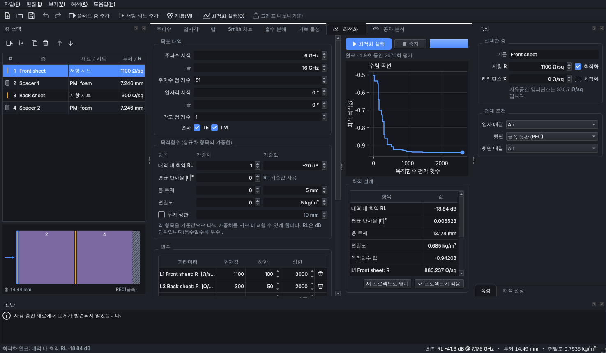

# Coating Studio

[English](README.md) | **한국어**

Coating Studio는 평면 다층 코팅을 시뮬레이션하고 최적화하는 크로스플랫폼(Windows, macOS, Linux) 데스크톱 프로그램입니다. v1은 **마이크로파·레이더 전파 흡수체**(GHz 대역)를 다룹니다. 물리 엔진은 범용으로 설계되어 있어서, 나중에 광학 코팅(복사 냉각, 반사방지)을 추가할 때 엔진을 다시 쓸 필요가 없습니다.



## 주요 기능

- **물리 엔진**: 평면 다층 구조를 전송선(임피던스) 재귀로 해석합니다.
  - TE·TM 사입사를 지원합니다.
  - 분기 절단이 안전한 종방향 파수를 써서, 두껍거나 손실이 큰 층에서도 수치 오버플로가 생기지 않습니다.
  - 포인팅 벡터로 층별 흡수를 구하며, R + T + ΣA = 1을 테스트로 검증합니다.
- **층**: 세 가지 요소로 구조를 만듭니다.
  - 임의 재료의 슬래브 층
  - 두께가 0인 **저항 시트**: Zs = R + jX [Ω/sq]
  - **금속(PEC)** 또는 **반무한 매질** 뒷면
- **재료**: 네 가지 방식으로 정의합니다.
  - 상수 복소 ε, μ
  - 다항 **Debye·Lorentz** 분산 모델: Snoek형 페라이트 완화와 전도도 σ를 포함합니다.
  - **측정 CSV** 데이터
  - **Maxwell-Garnett·Bruggeman** 실효 매질 혼합
- **재료 검사**:
  - **측정 CSV → 분산 모델 피팅**: 인과적 모델을 얻어 측정 범위 밖으로도 외삽할 수 있습니다.
  - 수동성 경고
  - Snoek 한계 현실성 경고
- **결과 화면**:
  - 주파수별·입사각별 반사손실, |Γ|², 흡수율, 투과율
  - 주파수×입사각 맵
  - Smith 차트
  - 층별 흡수 분해
  - 재료의 ε(f)·μ(f) 곡선
- **최적화**:
  - 차분 진화(DE)로 전역 탐색하고, 선택적으로 L-BFGS-B로 국소 정밀화합니다.
  - 목적함수는 대역 내 최악 RL, 평균 반사율, 두께, 면밀도를 정규화한 가중합입니다. 두께 상한도 걸 수 있습니다.
  - 분산 모델 파라미터와 혼합 체적 분율을 포함해 모든 수치를 변수로 쓸 수 있습니다.
  - 층별로 **재료 후보 중에서 선택**할 수 있습니다. 조합 수가 적으면 모든 조합을 탐색합니다.
- **공차 분석**:
  - 두께, ε, μ, 시트 임피던스를 몬테카를로로 흔듭니다. 공차는 전체 기본값으로 주거나 층별로 줄 수 있습니다.
  - 백분위 밴드와 제조 수율을 보여 줍니다.
- **사용 편의**:
  - 층 스택·재료 편집의 실행 취소/다시 실행
  - `.coat` 프로젝트 파일(JSON)
  - 그래프는 PNG/SVG/PDF로, 데이터는 CSV로 내보내기
  - 라이트/다크 테마, 한국어/영어 전환, 반사손실 부호 표시 전환

## 설치와 실행

Python 3.10 이상이 필요합니다.

```bash
git clone https://github.com/SomersetMaugham/coating.git
```

```bash
cd coating
```

```bash
python -m pip install .
```

```bash
coating-studio
```

`python -m coating_studio`로도 실행할 수 있습니다. 프로젝트 파일을 바로 열려면 `coating-studio design.coat`처럼 실행합니다.

**Linux**에서는 Qt 시스템 라이브러리가 필요합니다. Debian/Ubuntu 기준 명령은 다음과 같습니다.

```bash
sudo apt-get install libegl1 libgl1 libxkbcommon-x11-0 libxcb-cursor0 fonts-noto-cjk
```

그래프의 한글은 설치된 폰트 중 하나로 표시합니다. Windows는 맑은 고딕, macOS는 Apple SD Gothic Neo, Linux는 Noto Sans CJK KR 또는 나눔고딕을 씁니다. 언어는 `편집 → 환경 설정`에서 바꿀 수 있고, 다시 시작한 뒤 적용됩니다.

### GUI 없이 엔진만 쓰기

```python
import numpy as np
from coating_studio.examples import salisbury
from coating_studio.core import solve

p = salisbury(10e9)
res = solve(p.structure, p.materials, np.linspace(8e9, 12e9, 5), theta_deg=[0, 30])
print(10 * np.log10(res.pol["TE"].R))   # 반사손실 [dB], 배열 크기 (5, 2)
```

## 규약

| 항목 | 규약 |
|---|---|
| 시간 의존성 | e^{+jωt}; ε = ε′ − jε″, μ = μ′ − jμ″ (ε″, μ″ > 0 이면 손실) |
| 반사손실 | RL = 20·log₁₀\|Γ\| (음수, −10 dB ≈ 90% 흡수). 화면 표시 부호는 환경 설정에서 바꿀 수 있습니다. |
| Γ | 접선 방향 전기장의 반사계수 |
| 층 순서 | 층 스택의 맨 위 행이 입사파를 마주합니다 |
| 화면 단위 | GHz, mm, 도, Ω/sq, S/m, g/cm³ (엔진 내부는 SI 단위) |
| Debye 항 | Δ / (1 + j f/f₀) |
| Lorentz 항 | Δ·f₀² / (f₀² − f² + j f γ) |

측정 CSV 파일은 `f, ε′, ε″[, μ′, μ″]` 열로 구성합니다. 주파수 단위는 머리글에서 읽고, 없으면 GHz로 봅니다. 데이터는 선형 보간하며, 측정 범위 밖은 오류로 처리합니다. 범위 밖이 필요하면 분산 모델로 피팅하세요. 합성 예제는 [`examples/synthetic_magnetic_composite.csv`](examples/synthetic_magnetic_composite.csv)에 있습니다.

기본 제공 재료 값은 **시연용 대표값**입니다. 특정 제품의 데이터시트 값이 아니므로, 실제 설계에는 측정 데이터를 쓰세요.

## 개발

```bash
python -m pip install -e ".[dev]"
```

```bash
python -m pytest
```

테스트는 엔진을 해석해와 비교합니다. 비교 대상은 Salisbury 스크린, Fresnel 반사와 Brewster 각, Dallenbach 입력 임피던스, 에너지 보존, 전반사, 두꺼운 고손실 층의 수치 안정성입니다. 이 밖에 혼합 규칙의 극한값, 피팅, 최적화, 공차 분석, 번역 누락, GUI 오프스크린 스모크 테스트도 포함합니다. CI는 Windows, macOS, Linux에서 이 테스트를 실행합니다.

구현 계획은 [docs/PLAN.md](docs/PLAN.md)에 있습니다.

## 라이선스

MIT 라이선스입니다. [LICENSE](LICENSE)를 참고하세요.
