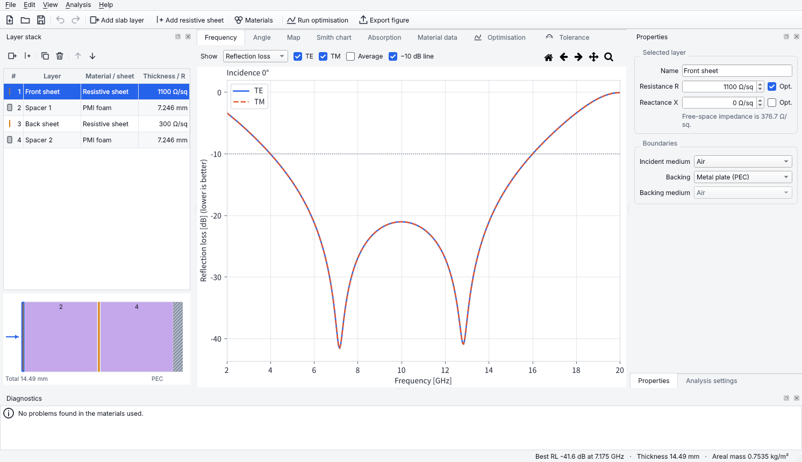
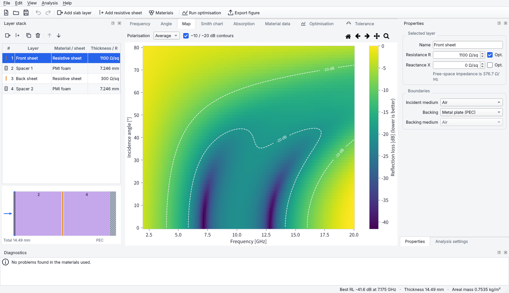
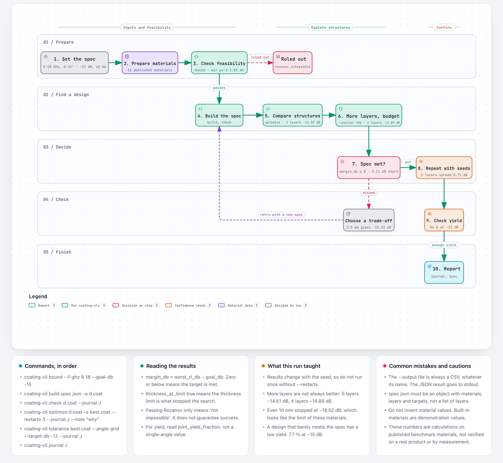

# Coating Studio

**English** | [한국어](README.ko.md)

Coating Studio is a cross-platform desktop application (Windows, macOS, Linux) for simulating and
optimising planar multilayer coatings. Version 1 focuses on **microwave and radar absorbers**
(GHz range); the physics engine is general so optical coatings (radiative cooling, anti-reflection)
can be added later without rewriting it.



## Features

- **Physics engine.** The solver uses transmission-line (impedance) recursion for planar stacks.
  - Oblique incidence, TE and TM.
  - A branch-safe longitudinal wavenumber, so thick or very lossy layers never overflow.
  - Per-layer absorption from the Poynting flux, with R + T + ΣA = 1 checked in the tests.
- **Layers.**
  - Slabs of any material.
  - Zero-thickness **resistive sheets** with Zs = R + jX in Ω/sq, or a **series RLC** equivalent circuit
    Zs(f) = R + jωL + 1/(jωC) for circuit-analog / FSS layers (L in nH, C in pF, optional capacitor;
    normal-incidence lumped values used for every angle and polarisation).
  - **Several resonances in one pattern**: add one RLC sheet per resonance and keep them next to each other. Adjacent
    sheets lie in the same plane, so they combine as 1/Zs = Σ 1/Zk in any order, at every angle and polarisation. Each
    sheet's R, L and C are optimised and varied separately; coupling between the resonators is not modelled.
  - A **metal (PEC)** or **semi-infinite** backing.
- **Materials.**
  - Constant complex ε and μ.
  - Multi-term **Debye / Lorentz / Havriliak-Negami** dispersion (Cole-Cole and Cole-Davidson as special cases),
    including Snoek-type ferrite relaxation and conductivity σ.
  - **Measured CSV** data.
  - **Power-law** fits ε′ = ε′(1 GHz)/fᵃ, ε″ = ε″(1 GHz)/fᵇ (and the same for μ), the form of the Michielssen 1993
    absorber database. They are curve fits, not causal models: use them only inside their fitted band.
  - **McLachlan GEM** mixtures for conductive fillers, continuous through a percolation threshold you supply
    (with an exponent t), for carbon black and CNT that percolate far below Bruggeman's 1/3; `coating-cli fit-gem`
    fits pc and t from composites at several loadings.
  - **Maxwell-Garnett / Bruggeman** effective-medium mixtures, and **Odelevskiy** for flakes and fibres (shape factor
    N and percolation threshold, which you supply; their ratio N/pc can be fitted from several loadings).
  - **Uniaxial** materials (axis along the layer normal) with separate in-plane and normal ε, μ, for flake fillers
    aligned in the coating plane; the normal components act at oblique incidence.
- **Measured S-parameters → ε, μ.** `coating-cli extract-nrw` extracts a sample's ε(f) and μ(f) from a two-port `.s2p`
  (coax, free space or rectangular waveguide; Nicholson-Ross-Weir) with a phase-branch check and half-wave warnings;
  the material manager has the same as **New → Extract from S-parameters (.s2p)…**.
- **Material checks.**
  - **CSV → dispersion-model fitting**, which gives a causal model you can extrapolate.
  - **Filler inversion** from one measured composite ("Invert filler…" or `coating-cli invert-filler`). The result holds
    effective values tied to the mixing rule and loading, not measured filler properties, and has been verified on
    synthetic data only.
  - **Odelevskiy ratio fit** from composites at several loadings (`coating-cli fit-shape`). Measurements fix only
    N/pc, never N and pc separately. Verified on synthetic data only.
  - Passivity warnings.
  - Snoek-limit realism warnings.
- **Results.** The result views are:
  - Reflection loss / |Γ|² / absorptance / transmittance vs frequency and vs angle.
  - A frequency × angle map.
  - A Smith chart.
  - A per-layer absorption breakdown.
  - Material ε(f), μ(f) curves.
- **Optimisation.**
  - Differential evolution with an optional L-BFGS-B polish.
  - **Spec targets**: a list of requirements, each a band × angle range × polarisations with its own
    goal level (e.g. X band ≤ −20 dB at normal incidence and Ku band ≤ −10 dB up to 45°). The optimiser
    minimises the worst margin (worst RL minus goal); the results list each target as met or missed, and
    the Frequency tab draws the targets as a mask. IEEE letter-band presets are built in.
  - Weighted, normalised objective terms: worst-case RL, mean reflectance, thickness and areal mass, plus an optional thickness limit.
  - Any numeric parameter can be a variable, including dispersion parameters and the volume fraction of a mixture.
  - Each layer's material can be **chosen from a list of candidates**. Small candidate sets are searched exhaustively.
  - **Robust mode** optimises for manufacturing yield: the worst case is taken over fixed tolerance samples, as the
    share of samples that must meet every target.
- **Tolerance analysis.**
  - Monte-Carlo perturbation of thickness, ε′, ε″, μ′, μ″ and sheet impedance, set globally or per layer.
    The loss parts vary independently of the real parts (so tan δ varies too), or follow them (tan δ fixed);
    RLC sheets vary R, L and C independently.
  - Material parameters can be varied too (a mixture's volume fraction, a dispersion term's f₀, …), so a process
    error can shift a relaxation or a resonance along the frequency axis.
  - Shows a percentile band and the manufacturing yield.
- **Interface.**
  - Undo/redo for edits to the layer stack and materials.
  - `.coat` project files (JSON).
  - Export figures as PNG/SVG/PDF and data as CSV.
  - **Reference curves**: pin the current design (Ctrl+Shift+P) or import a measured RL curve (CSV) and
    compare it on the Frequency, Angle and Smith chart tabs. Pinned designs are re-solved under the
    current sweep, so changing the angle or band keeps the comparison fair. The optimiser pins
    "Before optimisation" automatically when a result is applied. Up to 6, kept for the session.
  - Light and dark themes, English/Korean UI, and a choice of reflection-loss sign convention.



## Install and run

You need Python 3.10 or newer.

```bash
git clone https://github.com/SomersetMaugham/coating.git
```

```bash
cd coating
```

```bash
python -m pip install .
```

```bash
coating-studio
```

You can also start it with `python -m coating_studio` or open a project directly: `coating-studio design.coat`.

On **Linux**, Qt needs a few system libraries. On Debian/Ubuntu:

```bash
sudo apt-get install libegl1 libgl1 libxkbcommon-x11-0 libxcb-cursor0 fonts-noto-cjk
```

Korean text in plots uses Malgun Gothic (Windows), Apple SD Gothic Neo (macOS) or Noto Sans CJK KR /
NanumGothic (Linux) when they are installed.

### Using the engine without the GUI

```python
import numpy as np
from coating_studio.examples import salisbury
from coating_studio.core import solve

p = salisbury(10e9)
res = solve(p.structure, p.materials, np.linspace(8e9, 12e9, 5), theta_deg=[0, 30])
print(10 * np.log10(res.pol["TE"].R))   # reflection loss [dB], shape (5, 2)
```

### Command line for agents and scripts (`coating-cli`)

`coating-cli` runs the engine without Qt. Every command prints one JSON object on stdout (CSV with
`--format csv`), and progress goes to stderr with `--progress`. Exit codes: 0 ok, 2 usage, 3 input/output,
4 model, 5 stopped with a partial result.

```bash
coating-cli examples save salisbury -o sal.coat
coating-cli check sal.coat                                  # model, materials, feasibility (Rozanov bound)
coating-cli solve sal.coat --targets --summary-only         # best RL and margin per target
coating-cli optimize sal.coat -o sal_opt.coat --restarts 3 --timeout 60
coating-cli tolerance sal_opt.coat --corners                # yield at each target angle/polarisation
coating-cli spec sal_opt.coat -o design.json                # editable design spec; `build` turns it back into .coat
```

AI agents that iterate on a design until a target is met should follow
[`docs/AGENT_PLAYBOOK.md`](docs/AGENT_PLAYBOOK.md) (design specs, experiment journal, stop rules).

## Example workflow

From a specification to a design with `coating-cli`. The numbers come from one example run (8–18 GHz, 0–45°, TE and TM,
−15 dB, at most 3 mm) on the published Michielssen 1993 benchmark materials. They are calculations, not measurements of
a real product.



## Conventions

| Item | Convention |
|---|---|
| Time dependence | e^{+jωt}; ε = ε′ − jε″, μ = μ′ − jμ″ (ε″, μ″ > 0 are lossy) |
| Reflection loss | RL = 20·log₁₀\|Γ\| (negative; −10 dB ≈ 90 % absorbed). The display sign can be switched in Preferences. |
| Γ | Reflection coefficient of the tangential electric field |
| Layer order | The top row of the layer stack faces the incident wave |
| Units (UI) | GHz, mm, degrees, Ω/sq, S/m, g/cm³ (the engine works in SI) |
| Debye term | Δ / (1 + j f/f₀) |
| Havriliak-Negami term | Δ / (1 + (j f/f₀)^α)^β, 0 < α, β ≤ 1 |
| Lorentz term | Δ·f₀² / (f₀² − f² + j f γ) |

Measured CSV files contain `f, ε′, ε″[, μ′, μ″]`. The frequency unit is read from the header and
defaults to GHz. Optical data can be given as a refractive index instead: name the value columns
`n, k` (or just `n` for a lossless material, μ = 1). The first header cell may also be a wavelength
(`nm`, `µm`, `mm`; a bare `wavelength`/`wl` heading means µm) or a wavenumber (`cm-1`).
refractiveindex.info's two-block export (`wl,n` then `wl,k`) is read directly. A loss column may be given as a loss tangent instead: name it `tan d` (also `tan δ`, `tand`,
`loss tangent`, …) and it is converted with ε″ = ε′·tan δ (or μ″ = μ′·tan δ for the 5th column). Data is linearly interpolated, and evaluating outside the measured range is an
error, so fit a dispersion model if you need to extrapolate. A synthetic example is in
[`examples/synthetic_magnetic_composite.csv`](examples/synthetic_magnetic_composite.csv).

Validation against analytic results, a commercial datasheet and published measurements is in
[`examples/validation`](examples/validation/README.md).

The built-in materials use **representative, textbook-order values for demonstration**. They are
not datasheet values; use measured data for real designs.

## Development

```bash
python -m pip install -e ".[dev]"
```

```bash
python -m pytest
```

The tests check the engine against analytic results: a Salisbury screen, Fresnel reflection and the
Brewster angle, the Dallenbach input impedance, energy conservation, total internal reflection, and
numerical stability with thick, very lossy layers. They also cover mixing-rule limits, fitting, the
optimiser and tolerance analysis, translation coverage, and offscreen GUI smoke tests. The CI workflow can run
them on Windows, macOS and Linux; it is started by hand (Actions → CI → Run workflow).

The implementation plan is in [docs/PLAN.md](docs/PLAN.md).

## License

MIT, see [LICENSE](LICENSE).
